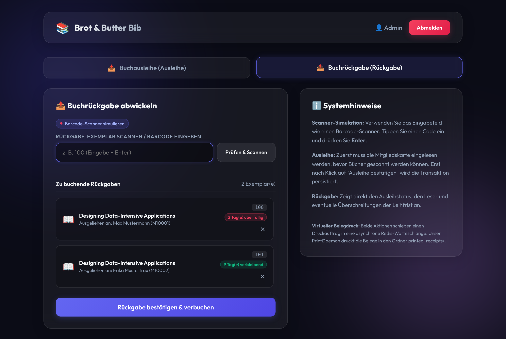
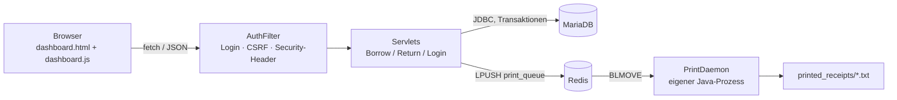

# ExLibris – Bibliotheksverwaltung


Webanwendung für die Ausleihe und Rückgabe von Büchern in der (fiktiven) Bibliothek **Brot & Butter**.
Entwickelt im Team (4 Studierende) im Modul *Softwareengineering II* an der Hochschule Bremerhaven.



## Funktionen

- **Login für Mitarbeitende**: Passwörter als PBKDF2-Hash, Session-Timeout, Schutz gegen Session Fixation und CSRF
- **Ausleihe**: Mitgliedsausweis scannen, mehrere Exemplare erfassen, in *einer* Transaktion buchen
- **Rückgabe**: zeigt sofort, wer das Exemplar hat und ob es überfällig ist; mehrere Mitglieder in einem Vorgang möglich
- **Asynchroner Belegdruck**: Belege laufen über eine Redis-Warteschlange zu einem eigenen PrintDaemon-Prozess, sodass ein langsamer oder ausgefallener Drucker die Ausleihe nicht blockiert
- **Lasttests** mit `hey`/`wrk` inklusive Latenz-Diagramm (gnuplot)

## Architektur



| Baustein | Aufgabe |
|---|---|
| `AuthFilter` | Prüft bei jeder Anfrage den Login, verlangt bei POST ein CSRF-Token und setzt Sicherheits-Header (CSP, X-Frame-Options, …) |
| `ApiServlet` | Gemeinsame Basis der JSON-Servlets: Eingabeprüfung, einheitliche Fehlerantworten |
| `LibraryDao` | Alle SQL-Zugriffe; Ausleihe/Rückgabe atomar mit `SELECT … FOR UPDATE` |
| `PrintQueue` / `PrintDaemon` | Zuverlässige Warteschlange: kein Beleg geht verloren, auch wenn der Daemon abstürzt |
| `PrintCommand` | Command-Pattern: jede Belegart (`BorrowReceiptCommand`, `ReturnReceiptCommand`) druckt sich selbst |
| `Json` | Kleiner JSON-Serializer/Parser ohne externe Abhängigkeit |

### Wichtige Design-Entscheidungen

- **Keine doppelte Ausleihe bei gleichzeitigen Anfragen.** Die Exemplarzeile wird mit `SELECT … FOR UPDATE` gesperrt. Ein Test mit 10 parallelen Ausleihen desselben Exemplars ergibt genau eine Buchung.
- **Alles oder nichts.** Ist bei einer Ausleihe von 5 Exemplaren eines bereits verliehen, wird keines gebucht (Rollback).
- **Zuverlässiger Druck.** `BLMOVE` verschiebt einen Auftrag atomar nach `print_processing` und löscht ihn erst nach dem Schreiben des Belegs. Unterbrochene Aufträge werden beim Neustart wieder eingereiht, unlesbare landen in `print_failed`.
- **Ehrliche Rückmeldung.** Ist Redis nicht erreichbar, bleibt die Buchung gültig, aber die Oberfläche zeigt deutlich: *Beleg konnte nicht gedruckt werden*.

## Technik

Java 21 · Jakarta Servlets 6 · Apache Tomcat 10.1 · MariaDB · Redis (Jedis) · JDBC · Vanilla JavaScript · JUnit 5 · GitHub Actions

## Schnellstart (lokal)

Voraussetzungen: Java 21, Tomcat 10.1+ mit [MariaDB-JDBC-Treiber](https://mariadb.com/downloads/connectors/) in `tomcat/lib/`, MariaDB, Redis.

```bash
mkdir -p local && cp config.example.txt local/config.txt
```

`local/config.txt` anpassen (DB-Zugang, Redis), dann:

```bash
bin/import-database.sh
```

```bash
bin/build.sh --no-deploy
```

```bash
cp target/webapp.war "$CATALINA_HOME/webapps/exlibris.war"
```

```bash
bin/run-print-daemon.sh
```

Danach `http://localhost:8080/exlibris/` öffnen und mit **admin / admin** anmelden.
Testdaten: Mitglieder `M10001`–`M10003`; Exemplar `100` (überfällig), `101` (verliehen), `102` (frei) sowie `200000`–`200999`.

> Der Zugang `admin/admin` ist nur für die Entwicklung gedacht. Eigene Zugänge legt `bin/add-employee.sh <benutzer> "<Name>"` an.

## Deployment an der Hochschule (hopper)

```bash
bin/configure.sh
```

```bash
bin/import-database.sh
```

```bash
bin/build.sh
```

`configure.sh` liest die Zugangsdaten von hopper und schreibt `local/config.txt` (nicht im Git). `build.sh` lädt das WAR über den Tomcat-Manager hoch und prüft danach, ob die Anwendung antwortet.

## Tests

| Befehl | Was wird geprüft |
|---|---|
| `bin/test.sh` | 19 Unit-Tests (JUnit 5): JSON, Passwort-Hashing, Belege, Eingabeprüfung, sichere Dateinamen |
| `bin/check.sh` | End-to-End gegen die laufende Anwendung: Login, falsches Passwort, Ausleihe, Rückgabe, CSRF-Schutz, Logout |
| `bin/shellcheck-all.sh` | Statische Analyse aller Shell-Skripte |
| `bin/hey-loadtest-borrow.sh`, `bin/run-loadtest.sh` | Lasttest (2000 Requests, 20 parallel) mit Latenz-Diagramm |

Die [CI-Pipeline](.github/workflows/ci.yml) führt bei jedem Push die Unit-Tests aus und startet danach Tomcat, MariaDB und Redis für den kompletten End-to-End-Test inklusive PrintDaemon.

## API

Alle Endpunkte außer `login` und `session-status` brauchen eine Session. POST-Anfragen brauchen zusätzlich den Header `X-CSRF-Token` (Wert aus `session-status`).

| Methode | Pfad | Parameter | Antwort |
|---|---|---|---|
| POST | `/login` | `user`, `passwd` | Weiterleitung auf `dashboard.html` oder `login.html?error=1` |
| POST | `/logout` | – | `{success}` |
| GET | `/session-status` | – | `{loggedIn, user, name, csrfToken}` |
| GET | `/borrow?action=checkMember` | `code` | `{success, code, name}` |
| GET | `/borrow?action=checkExemplar` | `code` | `{success, code, title, author}` |
| POST | `/borrow` | `memberCode`, `exemplarCodes` (z. B. `100,101`) | `{success, printed, dueDate, message}` |
| GET | `/return?action=checkExemplar` | `code` | `{success, title, memberName, dueDate, overdue, timeDiffText}` |
| POST | `/return` | `exemplarCodes` | `{success, printed, receipts, message}` |

## Projektstruktur

```
app/            Weboberfläche (HTML/CSS/JS) und WEB-INF/web.xml
src/hbv/web/    Java-Quellcode (Servlets, DAO, PrintDaemon)
test/hbv/web/   Unit-Tests
bin/            Skripte für Build, Deploy, Datenbank, Tests, Lasttests
createdb.sql    Datenbankschema + Admin-Zugang + Mitglieder
mock_books.sql  1000 Bücher (erzeugt mit bin/generate_mock_books.py)
testdata.sql    Beispiel-Ausleihen
docs/           Erklärungen zu den Änderungen
```

## Team

<!-- Namen und Schwerpunkte der Teammitglieder eintragen -->
- …
